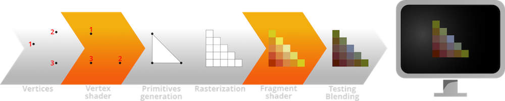
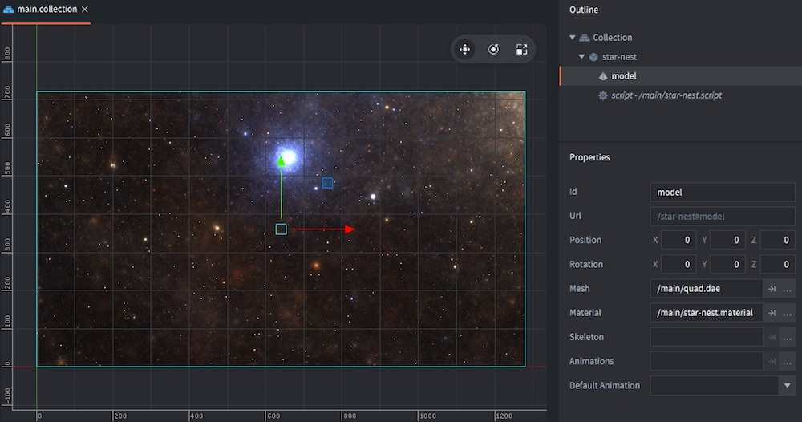

# Shadertoy sample

This sample shows how to take a Shadertoy shader and run it in Defold. The effect used here is **Star Nest**, a fragment shader by Pablo Román Andrioli, known as “Kali” on Shadertoy. You can find the original code [here](https://www.shadertoy.com/view/XlfGRj).

This document explains how it was setup to run properly in Defold.

Try [building and running](defold://project.build) the sample to see the shader in action.

## How It Works

The basic structure and idea of the project:

* The game object uses a **model component** with a simple quad mesh.
* The model uses a **material** that points to a **vertex shader** and a **fragment shader**.
* The material also defines which built-in constants the shaders can use.
* The material tag `tile` makes the quad match the default render script's sprites and tiles (2D visuals) pass.

There is no custom render script here. Defold provides the time data automatically to the sprite material through the material constant of type `Time` (available since Defold 1.12.3).

## Rendering

To understand the sample, it helps to know the basic rendering flow on the GPU.

Everything that is drawn to the screen starts as *vertices*, which are points in space that describe the shape of an object. A sprite is just a rectangle with four corner vertices. On the way to the final image, the GPU runs two shaders:

* The *vertex program* (or *vertex shader*) runs once per each vertex. It transforms the shape into screen space.

* Primitives are generated from the vertices.

* The primitives are *rasterized* - divided into "fragments" (or "pixels").

* The *fragment program* (or *fragment shader*) runs once per each fragment. It decides the final color of each pixel.

* The final result depends on how the colored shape should be blended with other overlapping graphics if there is translucency involved.

(See the [Shader manual](https://www.defold.com/manuals/shader/) for a more in-depth explanation on shaders.)

## Materials

Before the engine sends an object through the shader pipeline, it needs to know:

* Specify which vertex and fragment shader program to use to process the object data.
* Specify vertex and fragment constants that are used in the shader programs.
* Set samplers that are used in the fragment shader to do texture lookup.
* Specify which render pass the object belongs to. This is done with *tags* on the material.

Defold uses *materials* to hold that information. The material on the sample quad model (["/main/star-nest.material"](defold://open?path=/main/star-nest.material)) contains:

* A simple vertex shader program (["/main/star-nest.vp"](defold://open?path=/main/star-nest.vp)) that calculates vertex positions.

* The "Star Nest" fragment shader (["/main/star-nest.fp"](defold://open?path=/main/star-nest.fp)), adapted for Defold. This is the program that creates the star field.

* A *Vertex constant* named `view_proj`. This is an engine-supplied matrix containing the combined view and projection transform. The vertex shader uses it to place the quad on screen.

* A *Fragment constant* named `time`. This uses `CONSTANT_TYPE_TIME`, so the engine automatically supplies time data to the fragment shader. `time.x` is the time since engine start and `time.y` is the delta time from the last frame.

* No *Samplers* are set in the material because the fragment shader does not sample any textures.

* The tag `tile` is set on the material. That means the quad is drawn in the same pass as tiles and sprites when using the default render script. If you use a custom render script, make sure this tag is part of a predicate/pass there too.

## The sample setup

This sample is intentionally simple. The bootstrap collection (["/main/main.collection"](defold://open?path=/main/main.collection)) contains:

* A single game object called `star-nest`.
* A model component using a simple quad mesh (["/main/quad.dae"](defold://open?path=/main/quad.dae)). The mesh is 2x2 units large and extends from `-1` to `1` on both X and Y.
* The model is scaled 640 times along X and 360 times along Y so it covers the full 1280x720 display.
* The model uses the custom material (["/main/star-nest.material"](defold://open?path=/main/star-nest.material)).
* The shaders use the modern Defold shader pipeline with `#version 140`.

## Adapting another shader

If you are trying to build something similar, the easiest path is to copy this setup and then replace the fragment shader while keeping the same material and quad arrangement.
If you want to port another Shadertoy effect:

1. Start with a simple quad or other full-screen mesh.
2. Create a new custom material for the effect.
3. Adapt *vertex* or *fragment program*. Use `#version 140` shaders whenever possible.
4. Move built-in values like `view_proj` into uniform blocks.
5. Use `CONSTANT_TYPE_TIME` if the shader needs delta time or time since start values.

Check out the [documentation pages](https://defold.com/learn) for examples, tutorials, manuals and API docs.

If you run into trouble, help is available in [our forum](https://forum.defold.com).

---
